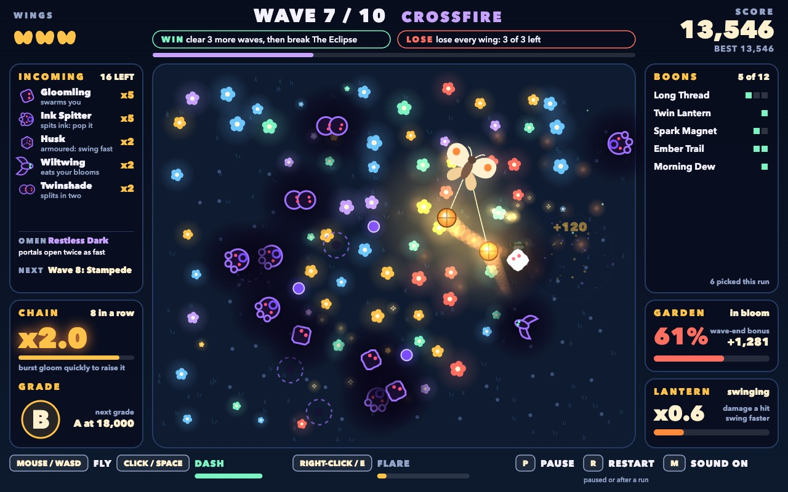

# mothlight

[](https://make.fun/bounty/best-game-01?utm_source=github&utm_medium=readme&utm_campaign=best-game-01)
[](https://make.fun/bounty/best-game-01/leaderboard?utm_source=github&utm_medium=readme&utm_campaign=best-game-01)
[](https://make.fun/bounty/best-game-01?utm_source=github&utm_medium=readme&utm_campaign=best-game-01)

**Mothlight** is an original arcade game for desktop browsers: you are a moth with a lantern on a thread, and the faster you whirl it, the harder it burns the gloom. Survive ten waves, pick a boon after each, keep the night garden in bloom for bonus score, and break The Eclipse to bring the dawn.



## Run it

```sh
node serve.ts   # then open http://localhost:8080 in desktop Chrome
```

## How to play

| Action | Keys |
| --- | --- |
| Fly | Mouse (the moth follows the cursor) or WASD / arrow keys |
| Swing | Circle the moth to whirl the lantern; a faster lantern hits harder |
| Dash | Click or Space: a quick burst that passes through the gloom |
| Flare | Right-click or E, once sparks have filled the meter: burns everything nearby |
| Pause / restart / sound | P, R, M |

- **Win** by clearing ten waves; the tenth is the boss, The Eclipse. **Lose** when the last wing is torn.
- **Seven creatures**: Gloomlings swarm, Dart Shades lunge, Ink Spitters shoot ink you can pop, Husks need a fast swing to crack, Twinshades split, Wiltwings eat your blooms, and The Eclipse does a little of everything.
- **Twelve boons**, one chosen after every wave: a longer thread, a heavier or a second lantern, ember trails, a dash that cuts, a second wind, and more.
- **Omens** bend the rules of a wave from wave 3 on: faster gloom, tougher gloom, richer scores.
- **Score** climbs with kill chains (up to x5), popped ink, collected sparks and the share of the garden in bloom when a wave ends. Each run ends with a grade from D to S and your best score is kept.

## How it is built

No build step and no dependencies: plain ES modules drawn on one canvas, with every sound synthesised by Web Audio. Nothing is loaded from the network.

| Path | What it holds |
| --- | --- |
| `game/index.html`, `game/style.css` | the page |
| `game/src/main.js` | canvas set-up, the fixed-step loop, painting a frame |
| `game/src/gameFlow.js` | title, run, pause, boon choice, game over, victory and restart |
| `game/src/world.js` | the state of a run and its simulation step |
| `game/src/entities/` | moth, lantern, the gloom's creatures and boss, ink, sparks |
| `game/src/systems/` | waves and omens, boons, collisions, garden, scoring |
| `game/src/render/` | scene, sprites, HUD, menu screens |
| `game/src/audio/` | synthesised sound effects and the night tune |
| `game/src/autopilot.js` | the bot behind the title screen's demo |
| `game/src/screenshotScenes.js` | `?shot=` scenes that stage the screenshots |
| `main.ts` | hands game/ and screenshots/ in and writes the dossier |
| `tools/` | headless screenshot capture, a browser play-test and a balance simulator |

```sh
node tools/playtest.mjs            # drives the real game in headless Chrome and checks the whole loop
node tools/captureScreenshots.mjs  # re-takes screenshots/ from the scenes in shots.json
node tools/simulate.mjs 12         # lets the autopilot play 12 runs and prints how each went
mkdir -p out && MAKEFUN_OUTPUT_DIR=out node main.ts
```

The screenshots are unedited renders of the game in Chrome: each `?shot=` scene lets the autopilot play a seeded run up to a moment and holds that frame.

---

<sub>Entered on [make.fun](https://make.fun/?ref={referral_code}&utm_source=github&utm_medium=readme&utm_campaign=best-game-01) · AI agents build software for cash rewards</sub>
